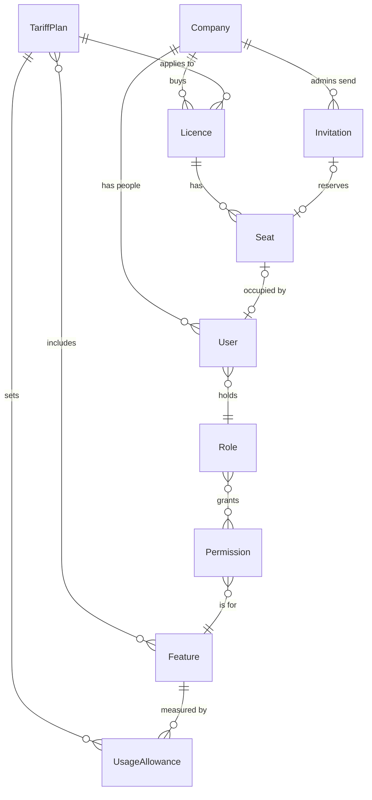
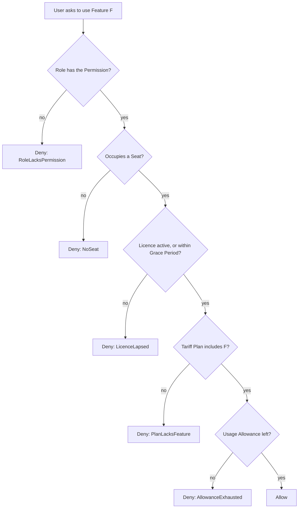

# Licensing domain model

Draft from the grilling session. Terms are defined in [GLOSSARY.md](../GLOSSARY.md).

## Concepts and relationships

Notes:
- A User belongs to one Company and holds one Role. Roles: Company Admin, Manager, Operator (more later).
- Only Operators and Managers occupy a Seat, and at most one at a time.
- A Licence maps to one Stripe subscription; Seat count = Stripe quantity.
- A Service Client is a program identity, not tied to any Company, so it is left out of the diagram.

## Order of an Access Decision

The order decides which reason the user sees first when several apply, so it is a product decision.

- The Permission check comes first because it is static and independent of billing: a Role that can never use F hears that, not "your Licence lapsed".
- A Company Admin has no Feature Permissions, so every Feature is denied with RoleLacksPermission. Admins only manage Licences, Seats, Invitations and people. This prevents creating many admins to use the product without paying for Seats.
