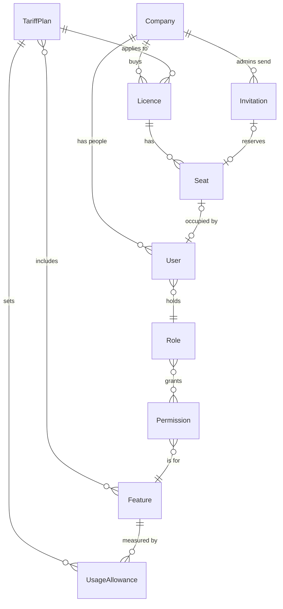
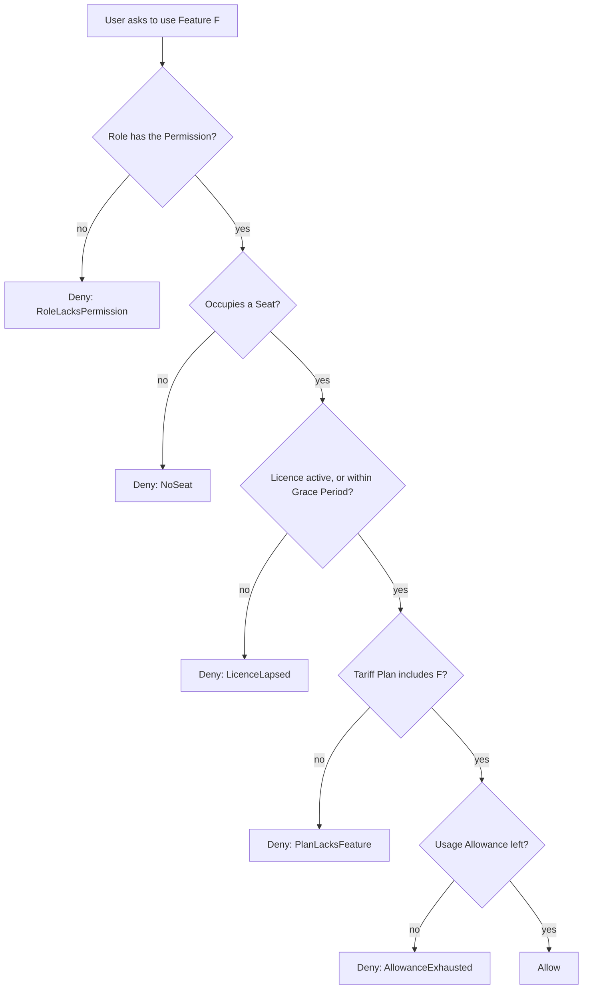

# Licensing domain model

Draft from the grilling session. Terms are defined in [GLOSSARY.md](../GLOSSARY.md).

## Concepts and relationships

Notes:
- A User belongs to one Company and holds one Role. Roles: Company Admin, Manager, Operator (more later).
- Only Operators and Managers occupy a Seat, and at most one at a time.
- A Licence maps to one Stripe subscription; Seat count = Stripe quantity.
- A Service Client is a program identity, not tied to any Company, so it is left out of the diagram.

## Order of an Access Decision

The order decides which reason the user sees first when several apply, so it is a product decision.

- The Permission check comes first because it is static and independent of billing: a Role that can never use F hears that, not "your Licence lapsed".
- A Company Admin has no Feature Permissions, so every Feature is denied with RoleLacksPermission. Admins only manage Licences, Seats, Invitations and people. This prevents creating many admins to use the product without paying for Seats.

## Decisions for the first slice

Agreed with the product owner while building slice 1 (issue #1). Where the spec was silent, these fill the gap.

**Storage**
- A Seat is a row of its own, linked to its Licence and optionally to the User who occupies it.
- Roles, Tariff Plans, Features and Permissions are loaded by a seed script (`prisma/seed.sql`, run with `pnpm db:seed`), not by service code.

**Seeded keys** (added, never renamed or reused)
- Roles: `company-admin`, `manager`, `operator`.
- Tariff Plans: `basic` (includes no Feature) and `standard` (includes `transcription`).
- Feature: `transcription`.
- Permission: `use-transcription`, held by `manager` and `operator`. `company-admin` holds none.

**Placeholders until login is designed** (login is out of scope for slice 1)
- `POST /users` with `{ name, email }` creates a person. It stands in for registration. The email is trimmed and lowercased.
- The acting User is passed in the `x-user-id` header. It stands in for authentication.

**Licence endpoints** (a stand-in for Stripe; the Stripe slice replaces how a Licence is created)
- `POST /companies/:id/licences` with `{ tariffPlan, seats }` creates an active Licence with that many Seats and returns its `id`.
- `GET /companies/:id/licences` lists each Licence with its Tariff Plan, total Seats and free Seats.

**Invitations** (agreed before step 4)
- An Invitation names an email address, not a User. The email is trimmed and lowercased.
- The emailed link carries a random secret token (at least 128 bits). Only a hash of it is stored. It works once and stops working when the Invitation is accepted, declined, cancelled or expired.
- Placeholder: no email is sent in slice 1, so `POST /companies/:id/invitations` returns the token in its response. This is removed when the email slice delivers the token only by email. The pending list never shows the token.
- `POST /companies/:id/invitations` with `{ email, role, licenceId }` and `GET /companies/:id/invitations` (pending ones, with email, Role and Licence). Accepting is called with the token when the person sets their first password.
- Only a Company Admin of the Company may invite. A second pending Invitation to the same email in the same Company is refused.
- Privacy comes first: the API never reveals whether an email already belongs to a User. An Invitation to an email that belongs to a User of another Company is created like any other and simply cannot be accepted.
- Invitation lifetime: 7 days by default, set by configuration.
- Sending the email is a later slice, done as a background job outside the database transaction.

**Accepting an Invitation** (agreed before step 4 continued)
- `POST /invitations/accept` with `{ token }` and the acting User in `x-user-id`. It is a stand-in for the call made when the person sets their first password.
- It succeeds only if the acting User's email equals the Invitation's email and the User belongs to no Company. The User then joins the Company in the offered Role and the Seat held by the Invitation becomes the User's Seat. The Invitation is used up.
- Every failure (wrong token, wrong email, User already in a Company, Invitation already used) gives the same answer, `404` with code `InvitationInvalid`, so the API reveals nothing about accounts.
