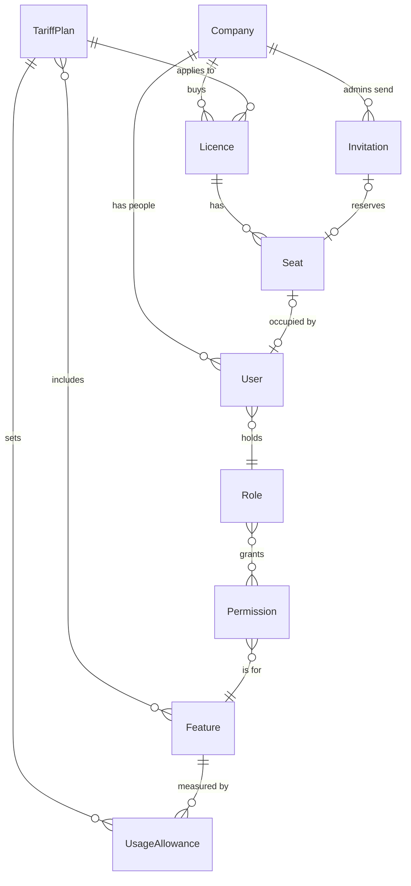
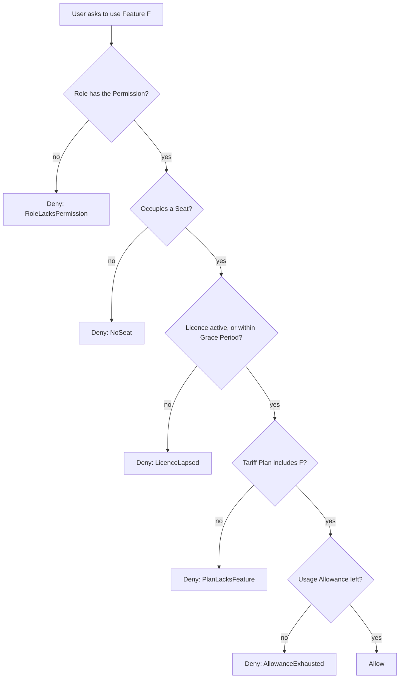

# Licensing domain model

Draft from the grilling session. Terms are defined in [GLOSSARY.md](../GLOSSARY.md).

## Concepts and relationships

Notes:
- A User belongs to one Company and holds one Role. Roles: Company Admin, Manager, Operator (more later).
- Only Operators and Managers occupy a Seat, and at most one at a time.
- A Licence maps to one Stripe subscription; Seat count = Stripe quantity.
- A Service Client is a program identity, not tied to any Company, so it is left out of the diagram.

## Order of an Access Decision

The order decides which reason the user sees first when several apply, so it is a product decision.

- The Permission check comes first because it is static and independent of billing: a Role that can never use F hears that, not "your Licence lapsed".
- A Company Admin has no Feature Permissions, so every Feature is denied with RoleLacksPermission. Admins only manage Licences, Seats, Invitations and people. This prevents creating many admins to use the product without paying for Seats.

## Decisions for the first slice

Agreed with the product owner while building slice 1 (issue #1). Where the spec was silent, these fill the gap.

**Storage**
- A Seat is a row of its own, linked to its Licence and optionally to the User who occupies it.
- Roles, Tariff Plans, Features and Permissions are loaded by a seed script (`prisma/seed.sql`, run with `pnpm db:seed`), not by service code.

**Seeded keys** (added, never renamed or reused)
- Roles: `company-admin`, `manager`, `operator`.
- Tariff Plans: `basic` (includes no Feature) and `standard` (includes `transcription`).
- Feature: `transcription`.
- Permission: `use-transcription`, held by `manager` and `operator`. `company-admin` holds none.

**Placeholders until login is designed** (login is out of scope for slice 1)
- `POST /users` creates a person with a name. It stands in for registration.
- The acting User is passed in the `x-user-id` header. It stands in for authentication.

**Licence endpoints** (a stand-in for Stripe; the Stripe slice replaces how a Licence is created)
- `POST /companies/:id/licences` with `{ tariffPlan, seats }` creates an active Licence with that many Seats and returns its `id`.
- `GET /companies/:id/licences` lists each Licence with its Tariff Plan, total Seats and free Seats.
